# template4j-site 全量回归测试报告

| | |
| --- | --- |
| **报告编号** | 2026-09-20-001 |
| **测试对象** | template4j-site 官网（Vue 3 + Element Plus 前端 @5173 / Spring Boot 后端 @8088，commit 工作区版本 0.5.0） |
| **测试日期** | 2026-09-20 |
| **测试方式** | Playwright（Chromium, 1440×900）驱动真实浏览器，逐业务线全量回归；截图留证 |
| **业务线** | 10 条 / **用例** 75 条 / **通过** 62 / **失败** 13 / **观察项** 2 |
| **配套文档** | [优化建议书](optimization-suggestions.md) · 各业务线明细报告 `bl-*/report.md` |

---

## 1. 总体结论

产品整体功能框架完整，**Learn 学习中心（含 36 例全量遍历）、Showcase、MCP、Docs 等业务线零缺陷通过**；但 **Playground（核心演练场）、全局体验层与后端服务存在 13 个确定性缺陷**，其中 4 个直接影响"开箱第一印象"或服务健康：

> 🔴 **TOP-4 阻断项**
> 1. **后端 trace 订阅泄漏** → Playground 用过 Trace 后，全站后端持续劣化，Perf 页实测提速倒挂 0.71x（干净基线 4.08x），最终接口挂起（DEF-11，jstack 实证）
> 2. **后端缺失 `/users`、`/orders` 等 mock 端点** → 首页 Hero 演示、Playground「Parallel mock」预设渲染失败（H-07 / P-02 / E-07 同根因）
> 3. **Playground 结果面板双重序列化** → 用户看到转义字符串而非 JSON 树（P-01 / P-11）
> 4. **Ctrl+Enter 快捷键失效 + 分享链接生成错误路径**（P-05 / P-09）

> 📌 执行说明：N-06（i18n 巡检精确化）与 BL-02→BL-06（缺陷复现需要）曾单独复跑，结论与首轮一致；BL-06 的 F-02 失败依赖「先跑 Playground Trace」的套件顺序，单独在干净后端上会通过——这正是缺陷的触发条件（见 DEF-11）。

### 1.1 业务线结果总览

| 业务线 | 用例 | 通过 | 失败 | 通过率 | 明细 |
| --- | ---: | ---: | ---: | ---: | --- |
| BL-01 门户与首页 | 7 | 6 | 1 | 86% | [report](bl-01-home/report.md) |
| BL-02 模板演练场 Playground（核心） | 17 | 12 | 5 | 71% | [report](bl-02-playground/report.md) |
| BL-03 精选示例 Showcase | 8 | 8 | 0 | 100% | [report](bl-03-showcase/report.md) |
| BL-04 学习中心 Learn | 10 | 10 | 0 | 100% | [report](bl-04-learn/report.md) |
| BL-05 在线试用 Try | 7 | 6 | 1 | 86% | [report](bl-05-try/report.md) |
| BL-06 性能基准 Perf | 4 | 3 | 1 | 75% | [report](bl-06-perf/report.md) |
| BL-07 MCP 集成 | 4 | 4 | 0 | 100% | [report](bl-07-mcp/report.md) |
| BL-08 文档中心 Docs | 4 | 4 | 0 | 100% | [report](bl-08-docs/report.md) |
| BL-09 全局导航与国际化 | 7 | 4 | 3 | 57% | [report](bl-09-nav-i18n/report.md) |
| BL-10 异常与容错（横切） | 7 | 5 | 2 | 71% | [report](bl-10-errors/report.md) |
| **合计** | **75** | **62** | **13** | **83%** | |

---

## 2. 业务线划分

基于产品功能架构，拆分为 8 条功能业务线 + 2 条横切业务线：

| 编号 | 业务线 | 覆盖范围 |
| --- | --- | --- |
| BL-01 | 门户与首页 | Hero 演示、CTA 跳转、功能卡片、依赖复制、统计区 |
| BL-02 | 模板演练场 Playground | 预设、JSON/YAML/String、渲染、Trace、快捷键、分享、持久化、文件加载（核心） |
| BL-03 | 精选示例 Showcase | 6 张示例卡、live 运行、互斥展开 |
| BL-04 | 学习中心 Learn | 侧栏导航、搜索、交互示例、翻页、404、36 例全量遍历 |
| BL-05 | 在线试用 Try | 双类型渲染、历史、清空 |
| BL-06 | 性能基准 Perf | 静态基准图、live benchmark、双语言 |
| BL-07 | MCP 集成 | 三步引导、配置复制、tools/list、render_template |
| BL-08 | 文档中心 Docs | markdown/可运行 section、Open in Try 联动 |
| BL-09 | 全局导航与国际化（横切） | 8 路由、404、中英切换、持久化、i18n 健康 |
| BL-10 | 异常与容错（横切） | 错误模板、非法数据、超限模板、断网恢复、全站巡检 |

---

## 3. 失败用例与证据（12 项）

### 3.1 🔴 DEF-01 后端缺 mock 端点，门面演示开箱即坏（H-07 / P-02 / E-07）

- **现象**：首页 Hero 的 parallel 演示输出面板只显示兜底文案；Playground「Parallel mock」预设渲染出组件错误堆栈；`curl /api/user?id=u-1` 返回 **500 `No static resource api/user`**。
- **影响**：官网第一屏演示、核心预设、Showcase 依赖同一组端点，新用户首次体验即"报错"。
- **修复意见**：site 后端补确定性 mock Controller（`/users/{id}`、`/orders`），或前端内置 mock 层解耦。
- **证据**：首页 Hero 降级文案 + Playground 预设错误面板：

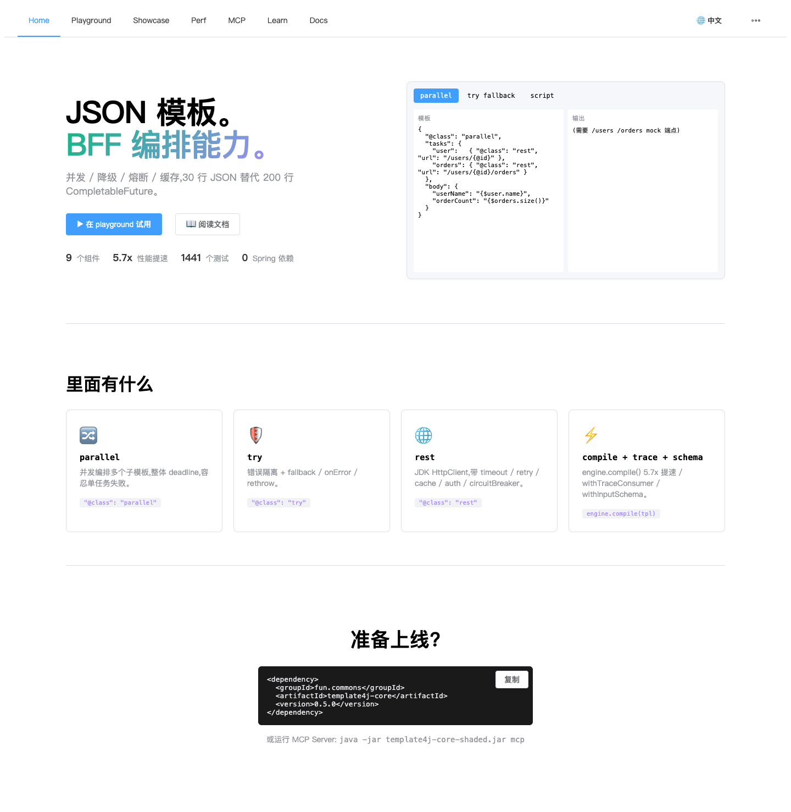

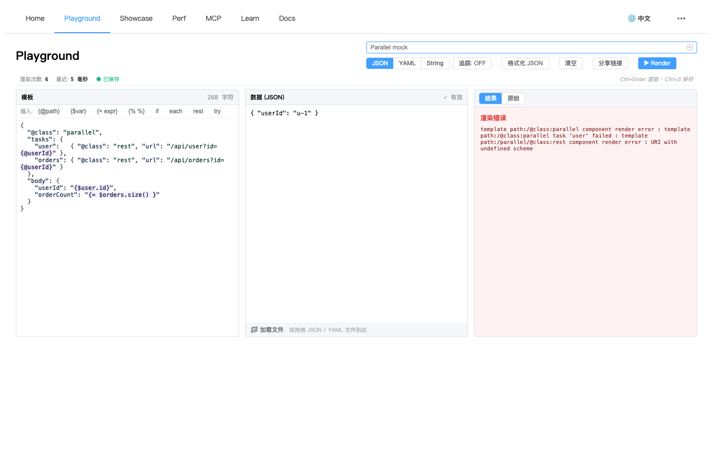

---

### 3.2 🔴 DEF-02 Playground 结果面板双重序列化（P-01 / P-11）

- **现象**：「结果」与「原始」tab 显示 `"{\n  \"msg\": \"Hello, alice!\"...}"` 转义字符串，而非格式化 JSON 树。
- **根因**：SSE `done` 事件的 `rendered` 已是 JSON 字符串，前端再次 `JSON.stringify`。
- **修复意见**：`typeof rendered === 'string' ? rendered : JSON.stringify(rendered, null, 2)`（结果/原始两处同源修复）。
- **证据**（「结果」tab 激活态内容为转义字符串）：

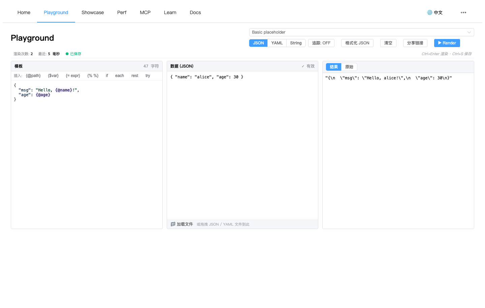

---

### 3.3 🔴 DEF-03 Ctrl+Enter 快捷键失效（P-05）

- **现象**：状态栏提示"Ctrl+Enter 渲染"，按键后渲染计数不变（2 → 2）。
- **根因**：`@keydown.ctrl.enter` 绑定在 `style="display:none"` 的 fallback textarea 上，可见 CodeEditor 不触发。
- **证据**（按键后渲染次数仍为 2）：

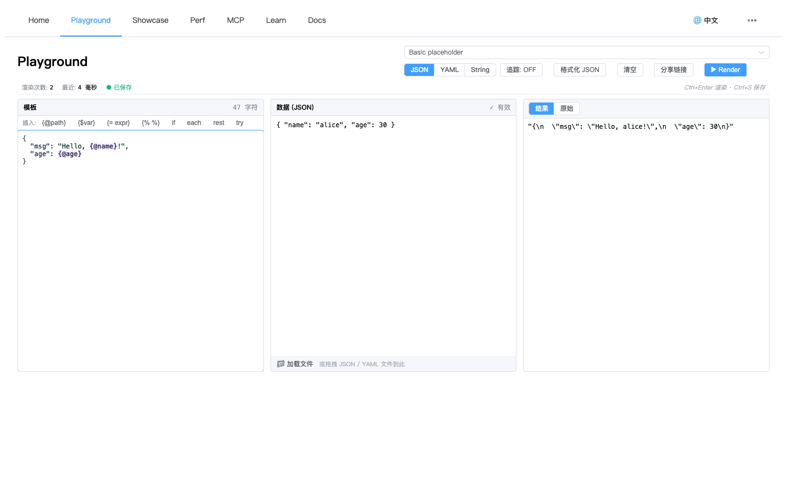

---

### 3.4 🔴 DEF-04 分享链接生成错误路径（P-09）

- **现象**：点击「分享链接」复制出 `http://localhost:5173/playgroundplayground?state=...`（404）。
- **根因**：`location.pathname + 'playground'` 重复拼接；state 回填逻辑本身正常（手工修正路径后可恢复模板 ✓）。
- **证据**（剪贴板内容可见错误路径；第二图为回填验证通过截图）：

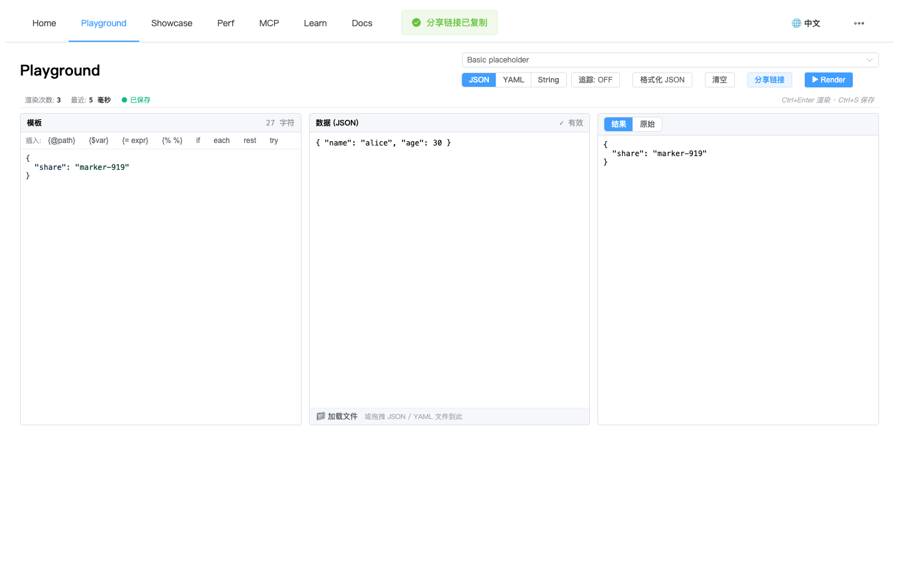

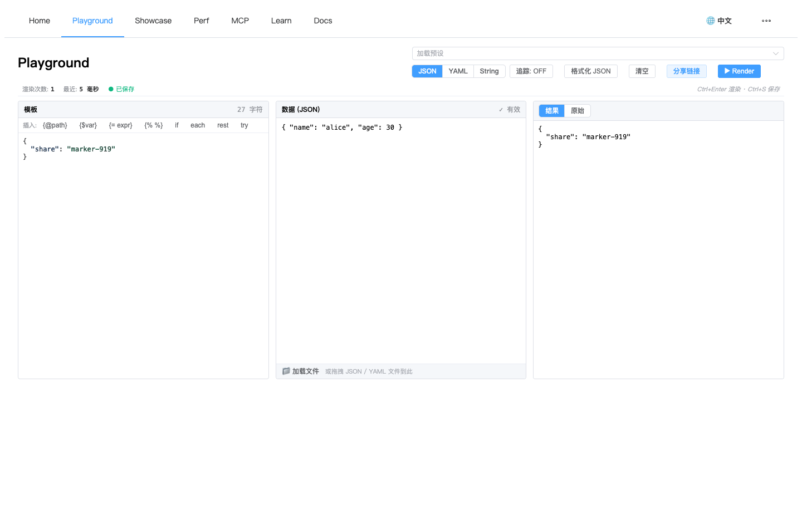

---

### 3.5 🟠 DEF-05 Try「清空」污染历史记录（T-06）

- **现象**：历史首条变为 `null...` 条目，点击"恢复"得到空模板。
- **根因**：`clear()` 调用 `setResult(null, 0, [])`，而 `setResult` 无条件 unshift 历史。
- **证据**（历史区首条 `13:01:07 null...`）：

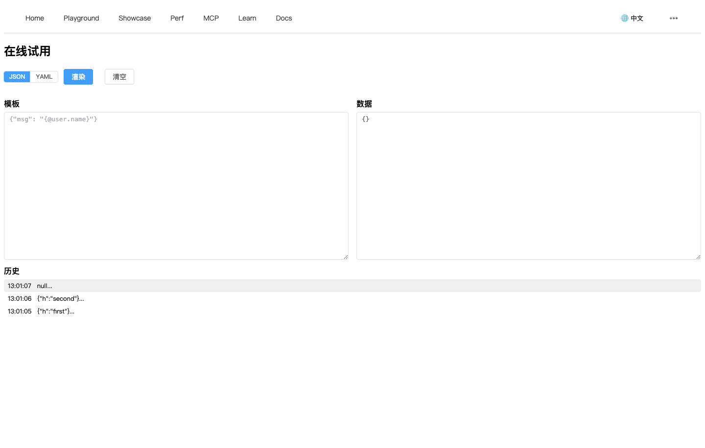

---

### 3.6 🟠 DEF-06 未知路径白屏，无 404 页（N-02）

- **现象**：访问 `/no-such-page-xyz` 内容区空白，无任何提示与出路。
- **根因**：vue-router 未配置 catch-all 路由。
- **证据**（白屏；右上角「…」同时是 DEF-08 的异物）：

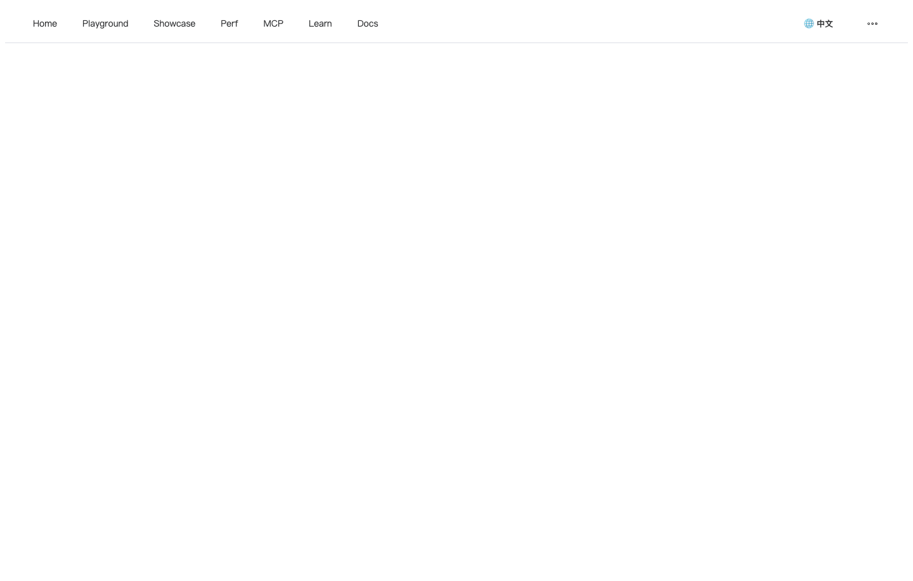

---

### 3.7 🟠 DEF-07 i18n 消息内嵌 HTML，触发 29 处 vue-i18n XSS 风险告警（N-06）

- **现象**：双语言 × 8 页巡检捕获 29 处 `[intlify] Detected HTML in ...` 告警（`perf.intro`、`perf.liveHint`、`mcp.step2Hint` 等配 `v-html` 渲染）。缺失 key 为 0 ✓。
- **修复意见**：文案纯文本化，用 `<i18n-t>` 组件/slot 承载 `<code>` 片段；CI 将 intlify 告警升级为 error。
- **证据**：[N-06-events.json](bl-09-nav-i18n/shots/N-06-events.json) · 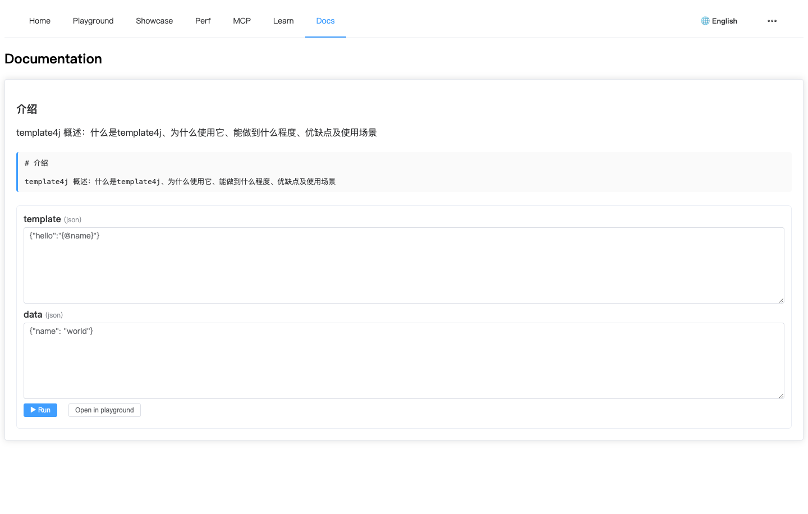

---

### 3.8 🟠 DEF-08 GitHub 外链不可见，导航栏出现「…」空菜单（N-07）

- **现象**：`App.vue` 在 `el-menu` 内写原生 `<li class="nav-gh">`，被 Element Plus 解析为空 `el-sub-menu`：链接 0×0 不可见，导航右上角多出一个「…」空菜单。
- **证据**（导航栏右上角无 GitHub 入口，仅有语言切换与「…」）：

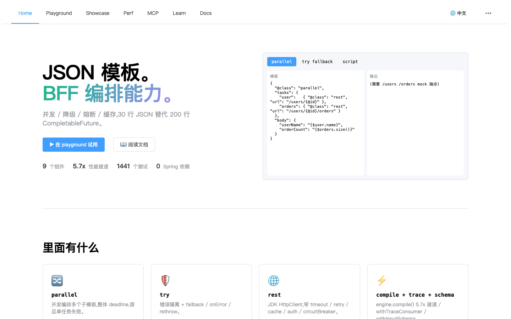

---

### 3.9 🟠 DEF-09 64KB 模板上限未生效（E-04）

- **现象**：配置声明 `max-template-size: 65536`，实测 70KB 模板照常渲染（无 4xx、无错误面板）。
- **修复意见**：`/api/try`、`/api/try/stream` 入口校验模板字节数；前端字数统计处提前预警。
- **证据**：


---

### 3.10 🟡 DEF-10 全站巡检残留 1 项 API 4xx（E-07）

- **现象**：8 页巡检中唯一异常为首页 Hero 演示的 `POST /api/try` 400（同 DEF-01 根因）。pageerror 全站为 0 ✓、请求失败 0 ✓。
- **证据**：[E-07-events.json](bl-10-errors/shots/E-07-events.json) · 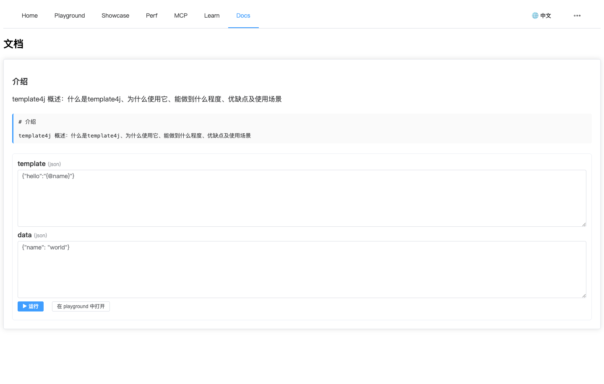

---

### 3.11 🔴 DEF-11 后端 trace 订阅泄漏：跨请求性能污染，最终接口挂起（F-02）

**最重要的后端发现**，由「BL-02 Playground Trace → BL-06 Perf」的套件顺序暴露，并经三轮复现 + jstack 定位：

| 后端状态 | bare avg | compiled avg | live 提速 | 页面宣称 |
| --- | ---: | ---: | ---: | ---: |
| 干净后端（单独跑） | 77,570 ns | 19,012 ns | **4.08x** ✓ | 5.7x |
| Playground 用过 Trace 之后 | 654,131 ns | 917,464 ns | **0.71x** ✗ 倒挂 | 5.7x |
| 继续使用（历史复现） | 8,975,758 ns | 11,474,212 ns | 0.78x ✗ | 5.7x |
| 持续压测 | `/api/demo/compile` 挂起 >4min，HTTP 线程单线程累计 CPU **235 秒**，栈顶停在 `StreamController.lambda$stream$0 → HashMap.putVal`（向已断开的 SSE 连接写 trace） | | | |

- **根因**：`StreamController` 的 SSE trace 订阅者在连接结束后未从共享 `RenderEngine` 反注册，后续任意请求（含 benchmark 的 5000 次循环）的 trace 事件继续写入死连接，无界累积。
- **影响**：① Perf 页 live benchmark 结果失真甚至倒挂（可信度）；② 后端随使用时间整体劣化（可用性）；③ 长驻进程内存无界增长（稳定性）。
- **修复意见**：SSE 会话结束（onComplete/onError/onTimeout）时反注册 trace 消费者，或将 trace 消费者挂到请求级 Context 而非共享引擎；`/api/demo/compile` 执行前重置引擎；回归用例 = Playground 开 Trace 后跑 benchmark，断言 speedup ≥ 基线的 50%。
- **证据**：[F-02-jstack-evidence.txt](bl-06-perf/shots/F-02-jstack-evidence.txt) · 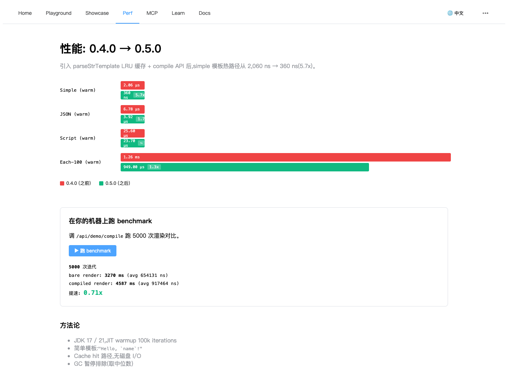

---

### 观察项（不计失败）

- **OBS-01**（N-05）：导航菜单硬编码英文，切中文后菜单不跟随（`nav.home='首页'` 等 i18n key 已存在未使用）。
- **OBS-02**（T-06 warn）：「清空」写入历史的条目在前端渲染为 `null...` 文本，观感差。

---

## 4. 通过业务线关键证据（摘选）

| 业务线 | 关键证据 | 说明 |
| --- | --- | --- |
| BL-01 首页 |  | Hero/功能卡/CTA/复制全通过 |
| BL-02 Playground | 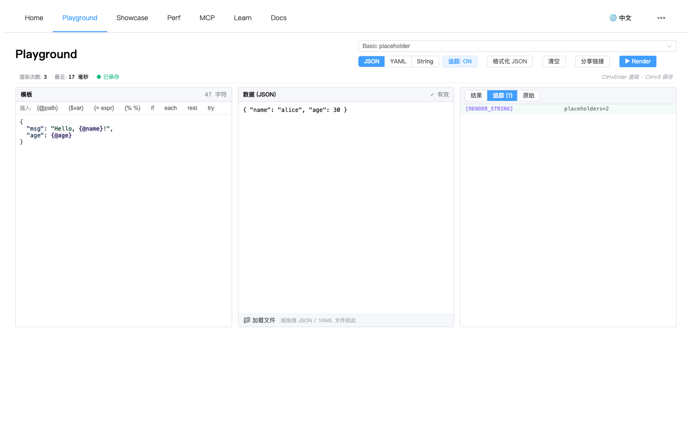 | 预设/渲染/格式化/YAML/文件/持久化/Trace 事件面板通过 |
| BL-03 Showcase | 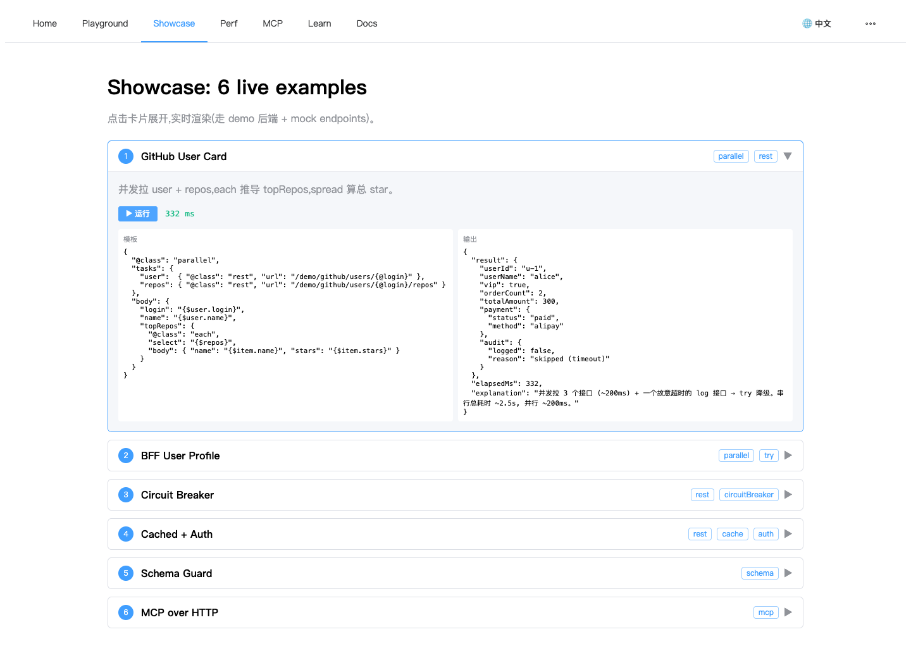 | 6 卡互斥展开、4 卡 live 运行、耗时展示全通过 |
| BL-04 Learn | 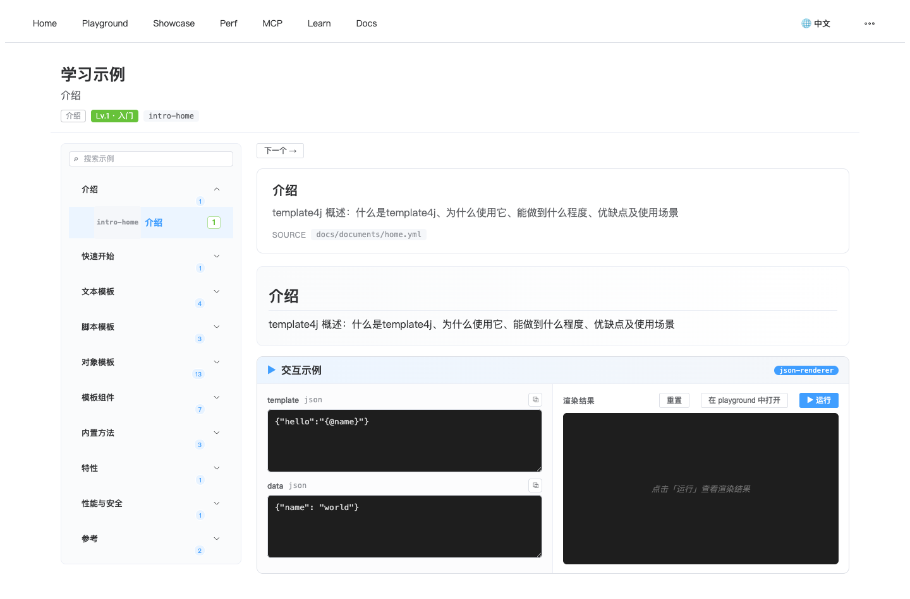 | 36 例全量遍历零失败、搜索/运行/翻页/404 通过 |
| BL-05 Try | 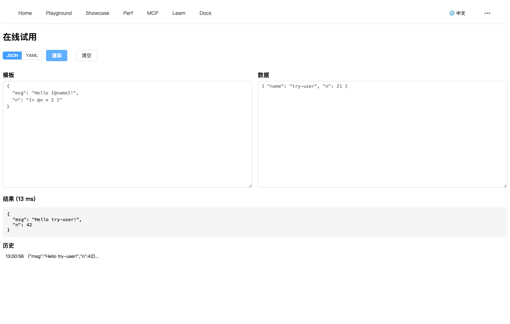 | JSON/YAML 渲染、错误兜底、清空通过 |
| BL-06 Perf | 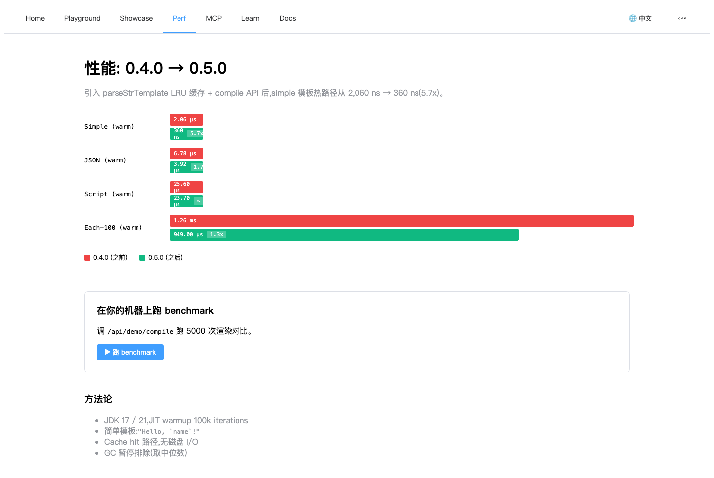 | 静态基准图/图例/方法论通过；live benchmark 干净后端 4.08x（套件顺序下触发 DEF-11） |
| BL-07 MCP | 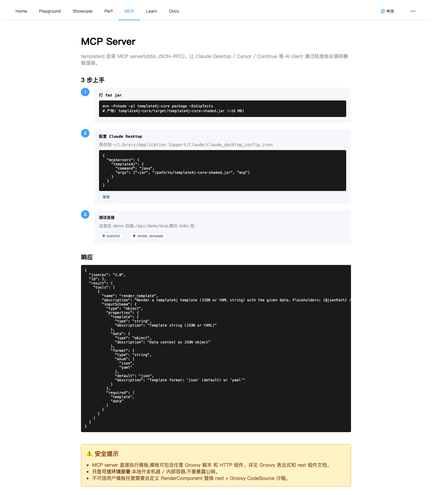 | tools/list 列出 render_template、配置复制通过 |
| BL-08 Docs | 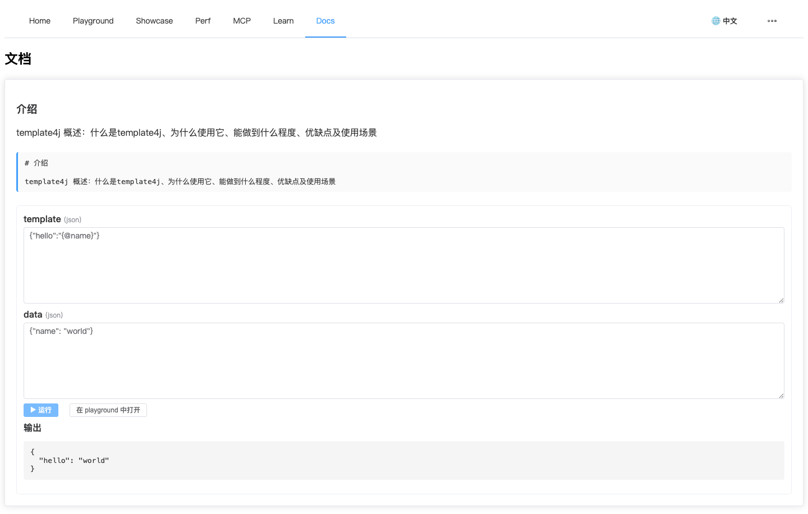 | markdown/可运行 section/Open in Try 通过 |
| BL-09 导航 i18n | 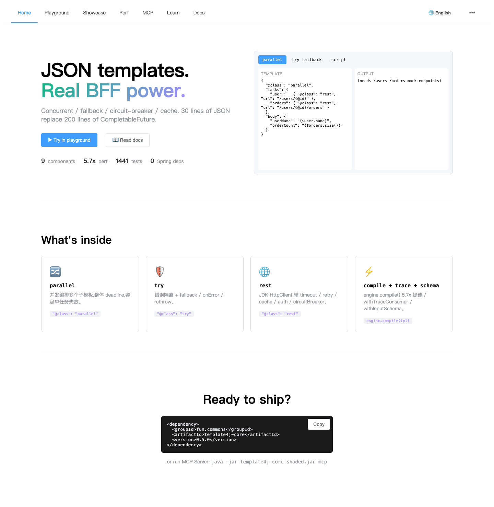 | 8 路由全通、中英切换+持久化通过（404/GitHub/i18n 见缺陷） |
| BL-10 容错 | 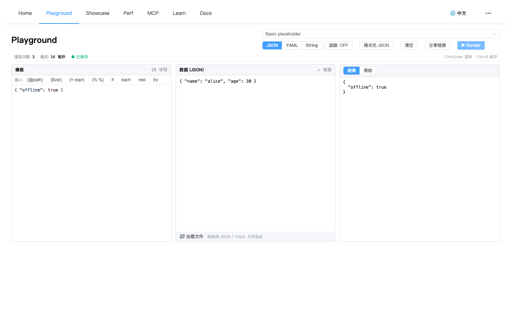 | 错误面板不崩、断网可恢复渲染、非法数据行内提示通过 |

完整证据（通过=关键图 / 失败=全过程图 + console/网络事件 `events.json`）见各 `bl-*/shots/`。

---

## 5. 修复优先级建议

| 优先级 | 缺陷 | 说明 |
| --- | --- | --- |
| P0（本周） | DEF-11 | 后端 trace 泄漏：跨请求污染 + 持续劣化 + 接口挂起 |
| P0（本周） | DEF-01、DEF-02 | 门面演示 + 核心输出可读性 |
| P0（本周） | DEF-03、DEF-04 | 状态栏明示功能失效 / 分享链路断裂 |
| P1（下个迭代） | DEF-05 ~ DEF-10 | 404、GitHub 入口、历史污染、模板上限、i18n HTML |
| 打磨项 | OBS-01、OBS-02 + [优化建议书](optimization-suggestions.md) | 界面人性化 / 功能合理化 / 布局仿大厂 |

---

## 6. 复跑方式

```bash
# 1) 启动后端与前端
java -jar template4j-site/target/template4j-site.jar &     # :8088
cd template4j-site/frontend && npx vite --port 5173 &      # :5173

# 2) 全量回归（10 条业务线, 输出至 test-report/<日期>-<序号>/）
for bl in e2e/regression/bl-*.mjs; do node "$bl"; done

# 3) 重新生成各业务线报告
node e2e/regression/gen-bl-report.mjs
```

*测试代码：`e2e/regression/`（Playwright, 复用 `e2e/lib` 基础设施）；本报告截图路径均可直接点击查看。*
