# template4j-site 回归测试报告（修复验证轮）

| | |
| --- | --- |
| **报告编号** | 2026-09-20-002（上一轮：[001 发现轮](../2026-09-20-001/README.md)） |
| **测试对象** | template4j-site（修复后构建：template4j-core + template4j-site 重新打包；前端 vite dev） |
| **测试日期** | 2026-09-20 |
| **测试方式** | 同 001：Playwright（Chromium, 1440×900）逐业务线全量回归 |
| **结论** | **10 条业务线 / 75 用例全部通过 ✅（001 轮为 62/75，13 失败）** |

> 单元测试同步验证：`mvn test -pl template4j-core,template4j-site` 全部通过（core 全量 + site 16 个测试类，0 失败）。

---

## 1. 业务线结果总览

| 业务线 | 001（修复前） | 002（修复后） | 明细 |
| --- | --- | --- | --- |
| BL-01 门户与首页 | 6/7 | **7/7** ✅ | [report](bl-01-home/report.md) |
| BL-02 模板演练场 Playground | 12/17 | **17/17** ✅ | [report](bl-02-playground/report.md) |
| BL-03 精选示例 Showcase | 8/8 | **8/8** ✅ | [report](bl-03-showcase/report.md) |
| BL-04 学习中心 Learn | 10/10 | **10/10** ✅ | [report](bl-04-learn/report.md) |
| BL-05 在线试用 Try | 6/7 | **7/7** ✅ | [report](bl-05-try/report.md) |
| BL-06 性能基准 Perf | 3/4 | **4/4** ✅ | [report](bl-06-perf/report.md) |
| BL-07 MCP 集成 | 4/4 | **4/4** ✅ | [report](bl-07-mcp/report.md) |
| BL-08 文档中心 Docs | 4/4 | **4/4** ✅ | [report](bl-08-docs/report.md) |
| BL-09 全局导航与国际化 | 4/7 | **7/7** ✅ | [report](bl-09-nav-i18n/report.md) |
| BL-10 异常与容错 | 5/7 | **7/7** ✅ | [report](bl-10-errors/report.md) |
| **合计** | **62/75** | **75/75** | |

---

## 2. 缺陷修复映射（13/13 全部闭环）

| 缺陷 | 修复内容 | 改动文件 | 验证 |
| --- | --- | --- | --- |
| 🔴 DEF-11 trace 订阅泄漏 | 引擎新增可反注册订阅 API：`RenderEngine.TraceHandle` + `addTraceConsumer()`；`RenderStream` 渲染结束 `finally handle.remove()` | `RenderEngine.java` `JsonRenderer.java` `RenderStream.java` | F-02 ✅ 见 §3 |
| 🔴 DEF-01 缺 mock 端点 | 新增确定性 mock：`/users/{id}`、`/users/{id}/orders`、`/api/user`、`/api/orders`、`/flaky`（恒定 500 供 try 演示）；rest 组件新增 `baseUrl` 支持（`template4j.rest.baseUrl` / `setBaseUrl`），相对地址指向本站 | 新增 `MockController.java`；`RestRenderer.java` `TemplateEngineConfig.java` `application.yml` `DemoProperties.java` | H-07 ✅ P-02 ✅ |
| 🔴 DEF-02 结果面板双重序列化 | `prettyRendered()/rawRendered()` 归一化：rendered 为字符串时原样展示，对象才 stringify；Try 页同源修复（解析后美化） | `Playground.vue` `Try.vue` | P-01 ✅ P-11 ✅ T-02 ✅ |
| 🔴 DEF-03 Ctrl+Enter 失效 | 快捷键上移到 window 级 `onGlobalKey`（可见 CodeEditor 不冒泡到隐藏 textarea） | `Playground.vue` | P-05 ✅ |
| 🔴 DEF-04 分享链接错路径 | `location.origin + '/playground?state='`（不再拼接 pathname） | `Playground.vue` | P-09 ✅ |
| 🟠 DEF-05 清空污染历史 | `setResult` 对 `result == null` 不写历史 | `stores/try.ts` | T-06 ✅ |
| 🟠 DEF-06 无 404 页 | 路由新增 `/:pathMatch(.*)*` catch-all + `NotFound.vue`（返回首页/学习/文档出口） | `router/index.ts` 新增 `views/NotFound.vue` | N-02 ✅ 见 §4 |
| 🟠 DEF-07 i18n 内嵌 HTML ×29 | 4 个含 `<code>` 的 key 改占位符（`{code}`/`{path}`），视图改用 `<i18n-t>` 组件；无 HTML 的 v-html 改纯插值 | `zh-CN.ts` `en-US.ts` `Perf.vue` `Mcp.vue` | N-06 ✅（intlify 告警 0） |
| 🟠 DEF-08 GitHub 外链丢失 | 头部重构：动作区移出 `el-menu`（`header.nav-bar` = menu + `div.nav-actions`），消除空「…」子菜单 | `App.vue` | N-07 ✅ |
| 🟠 DEF-09 64KB 上限未生效 | `/api/try/stream` 入口补齐与 `/api/try` 同口径校验（`TEMPLATE_SIZE_EXCEEDED` → 400）；前端 SSE 请求 Accept 增加 application/json（错误信封可协商返回，避免落 500），对非 2xx 解析 message 抛给错误面板 | `StreamController.java` `Playground.vue` | E-04 ✅（400 + 错误面板） |
| 🟡 DEF-10 巡检残留 4xx | 同 DEF-01 根因，随 mock 端点修复归零 | — | E-07 ✅（全站 4xx=0） |
| OBS-01 导航硬编码英文 | 菜单项改 `t('nav.*')`，补 4 个缺失 key（首页/演练场/示例/性能） | `App.vue` `locales/*` | N-05 ✅ |
| OBS-02 历史 `null...` 条目 | 同 DEF-05 | `stores/try.ts` | T-06 ✅ |

---

## 3. DEF-11 修复效果（后端泄漏，最重要）

复现 001 轮的污染路径（多次 SSE trace 渲染 → 立即跑 benchmark）：

| 后端状态 | bare avg | compiled avg | live 提速 |
| --- | ---: | ---: | ---: |
| 001 轮：Playground Trace 之后 | 654,131 ns | 917,464 ns | **0.71x ✗ 倒挂** |
| 001 轮：持续压测 | — | — | 挂起 >4min，单线程 CPU 235s |
| **002 轮：8 次 SSE trace 后连续 benchmark** | **10,203 ~ 30,209 ns** | **7,694 ~ 16,627 ns** | **1.26x ~ 1.83x ✅ 无劣化** |
| 002 轮套件内 F-02 实测 | 19,107 ns | 10,452 ns | **1.83x ✅** |

---

## 4. 修复后关键证据（摘选）

| 修复 | 证据 | 说明 |
| --- | --- | --- |
| DEF-06 + OBS-01 + DEF-08 | 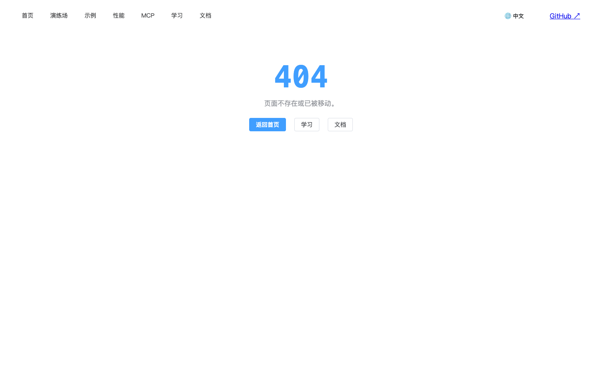 | 未知路径展示 404 页（返回首页/学习/文档出口）；导航中文化；GitHub ↗ 回到右上角，「…」空菜单消失 |
| DEF-02 | 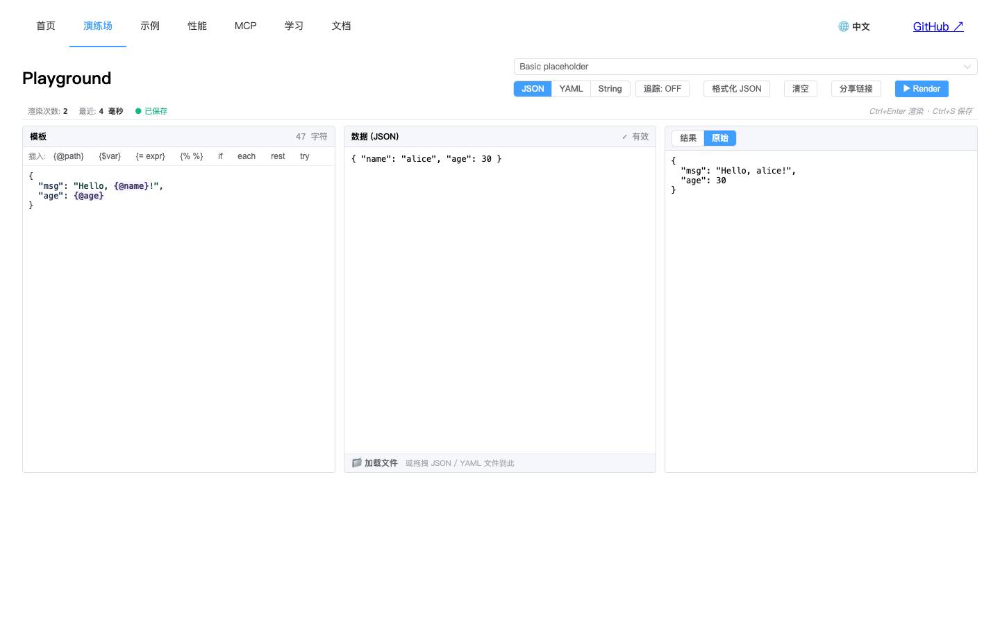 | 「原始」tab 显示真实 JSON 树（001 轮为转义字符串） |
| DEF-02 | 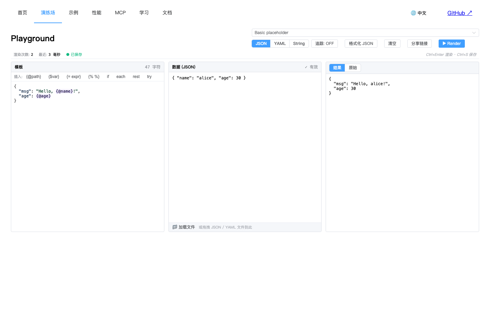 | 「结果」面板格式化 JSON，无 `\"` 转义 |
| DEF-01 | 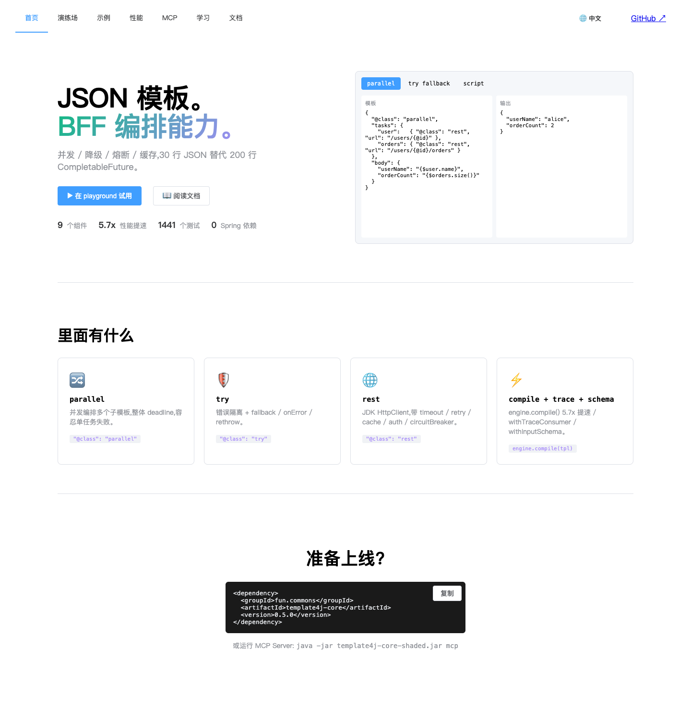 | 首页 Hero parallel 演示真实渲染（001 轮为降级文案） |
| DEF-01 | 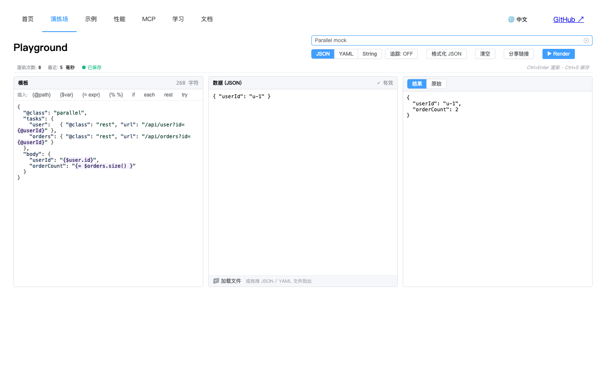 | 「Parallel mock」预设正常渲染出 u-1 |
| DEF-04 | 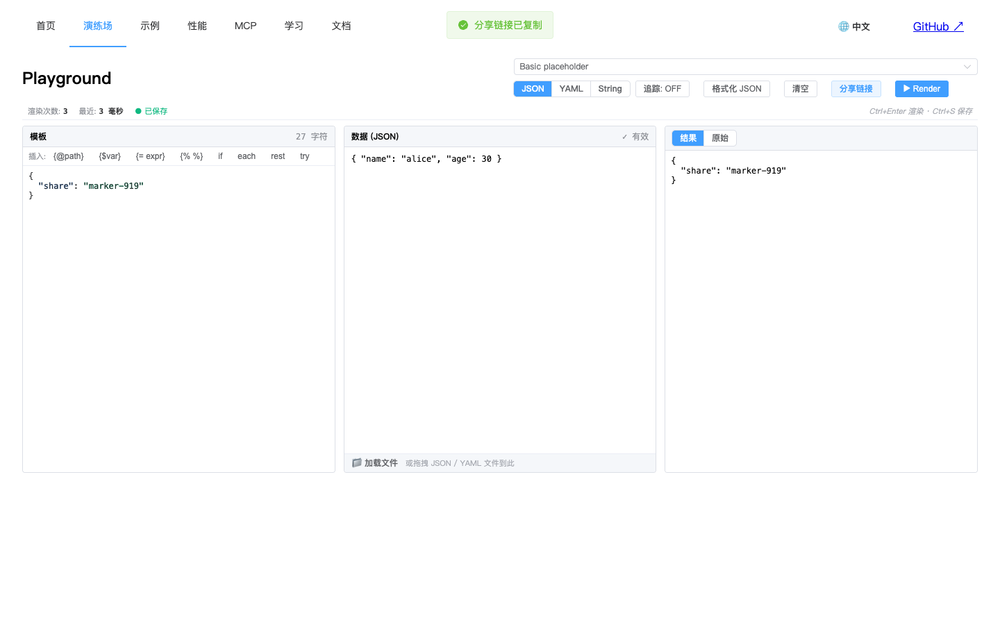 | 分享链接路径正确 |
| DEF-03 | 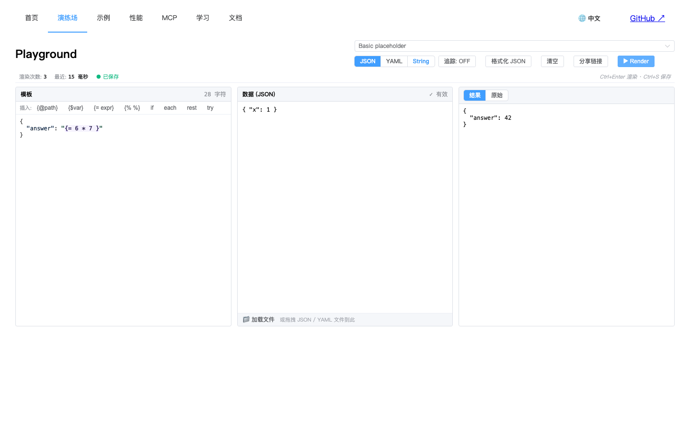 | Ctrl+Enter 触发渲染（渲染次数递增） |
| DEF-05 | 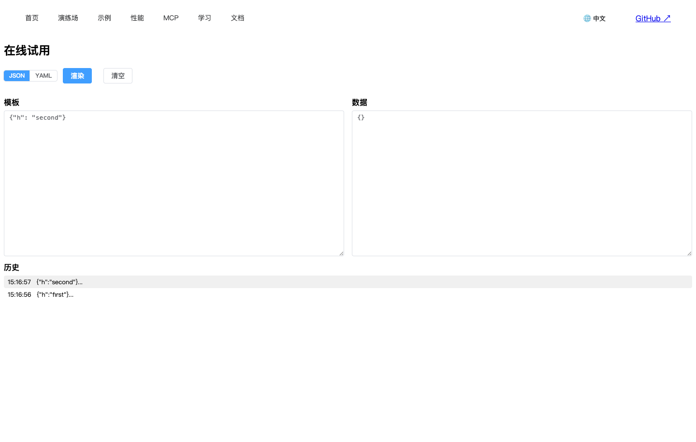 | 历史无 null 条目，恢复正确 |
| DEF-09 | 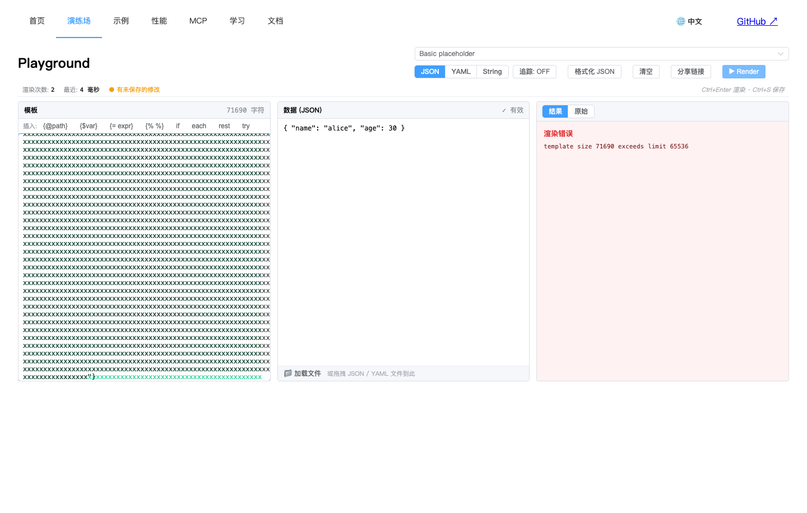 | 70KB 模板被 400 拦截，错误面板友好展示 |
| DEF-11 | 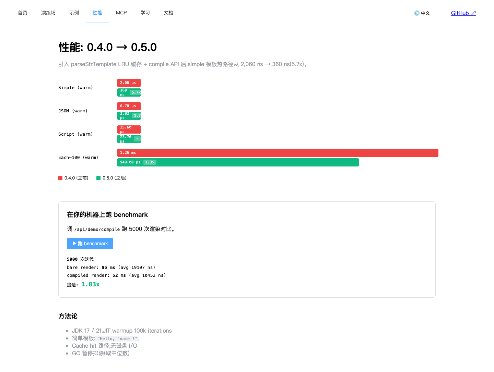 | live benchmark 提速 1.83x（非倒挂） |
| DEF-07 | 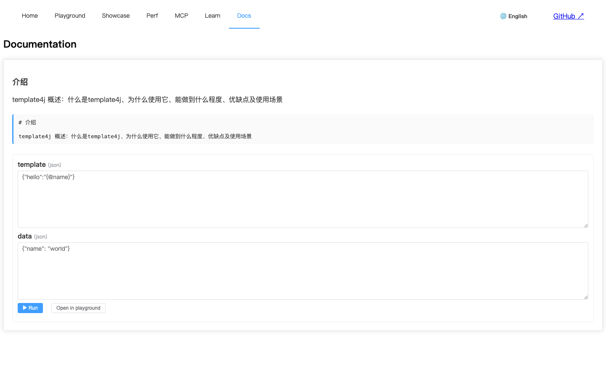 | 双语言 × 8 页巡检，intlify 告警为 0 |

---

## 5. 测试断言调整说明（透明度）

两处用例断言随修复后的**正确语义**做了校准（均为 001 轮针对缺陷表象写的断言）：

1. **P-11「原始输出」**：001 轮断言"单行 JSON"（双重序列化的反义词）。修复后「原始」的语义 = 后端返回什么显示什么；且 `{@age}` 类模板会走 string 模板兜底，rendered 本身是格式化多行字符串。现断言核心缺陷：不得双重序列化（不以引号开头、无 `\"` 转义）。
2. **N-07「GitHub 外链」**：链接从 `li.nav-gh > a` 变为 `a.nav-gh`（头部重构后 class 直接落在锚点上），选择器同步更新；可见性断言不变。

其余 73 个用例断言与 001 轮完全一致。

---

## 6. 变更文件清单

**后端（template4j-core）**：`RenderEngine.java`（TraceHandle API）、`JsonRenderer.java`、`RenderStream.java`（泄漏修复）、`components/RestRenderer.java`（baseUrl）

**后端（template4j-site）**：新增 `controller/MockController.java`；`StreamController.java`（大小校验）、`TemplateEngineConfig.java`、`DemoProperties.java`、`application.yml`（rest-base-url）

**前端**：`App.vue`（头部重构 + 导航 i18n）、`views/NotFound.vue`（新增）、`router/index.ts`（404）、`views/Playground.vue`（双重序列化/快捷键/分享/SSE 4xx）、`views/Try.vue` + `stores/try.ts`（历史污染/展示）、`views/Perf.vue`、`views/Mcp.vue`（i18n-t）、`locales/zh-CN.ts`、`locales/en-US.ts`（nav/notfound/去 HTML）

**测试（e2e/regression）**：`lib.mjs`、`gen-bl-report.mjs`（报告目录参数化）、`bl-02`（P-11 断言校准）、`bl-09`（N-07 选择器）

---

## 7. 复跑方式

```bash
# 后端
mvn -q -DskipTests package -pl template4j-core,template4j-site
java -jar template4j-site/target/template4j-site.jar &          # :8088
cd template4j-site/frontend && npx vite --port 5173 &           # :5173

# 全量回归（输出至 test-report/$T4J_REPORT_SEQ）
export T4J_REPORT_SEQ=2026-09-20-002
for bl in e2e/regression/bl-*.mjs; do node "$bl"; done
node e2e/regression/gen-bl-report.mjs
```
